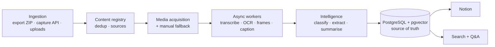

# Lore

**Personal content intelligence system.** Save or share something interesting → Lore captures it → AI understands it → it becomes structured, searchable knowledge → ask for it whenever you need it.

Instagram (saved collections and group-chat shares) is the first source. The design is source-agnostic, so YouTube, Pinterest and articles can come later.

> **Status:** design phase. No application code yet. *Lore* is a working name.

## Docs

| File | What it is |
|---|---|
| [`docs/SYSTEM_DESIGN.md`](docs/SYSTEM_DESIGN.md) | Full PRD + system design, with Mermaid diagrams (architecture, ingestion, media acquisition, pipeline, state machine, sequence, data model, search, roadmap) |
| [`docs/AGENT_KICKOFF.md`](docs/AGENT_KICKOFF.md) | First prompt for Claude Code / OpenCode, scoped to Phase 1 |
| [`docs/diagrams.html`](docs/diagrams.html) | The same design as a standalone page with pre-rendered diagrams (open locally in a browser) |

## Architecture at a glance

## Roadmap

1. **Foundation + historical import** ← *start here*
2. Extraction pipeline (STT · OCR · LLM)
3. Notion sync
4. Continuous capture (web form → Telegram bot)
5. Dashboard
6. Semantic search + Q&A
7. Itineraries, reading lists, digests, more platforms

## Stack

Python 3.12 · FastAPI · PostgreSQL + pgvector · Celery + Redis · FFmpeg · Whisper · PaddleOCR/Tesseract · LLM with structured output · Notion API · Docker Compose
