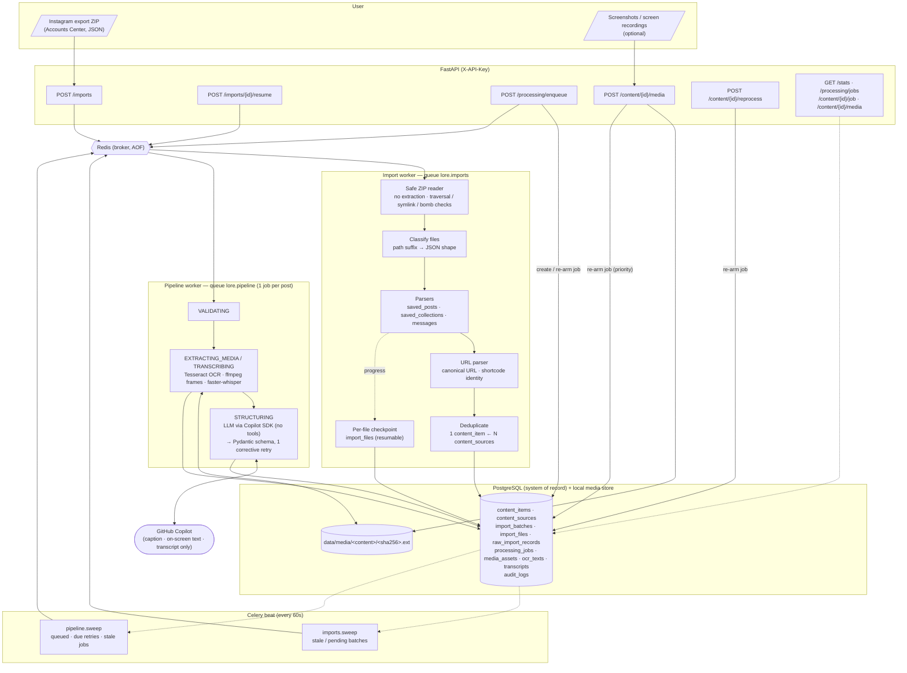
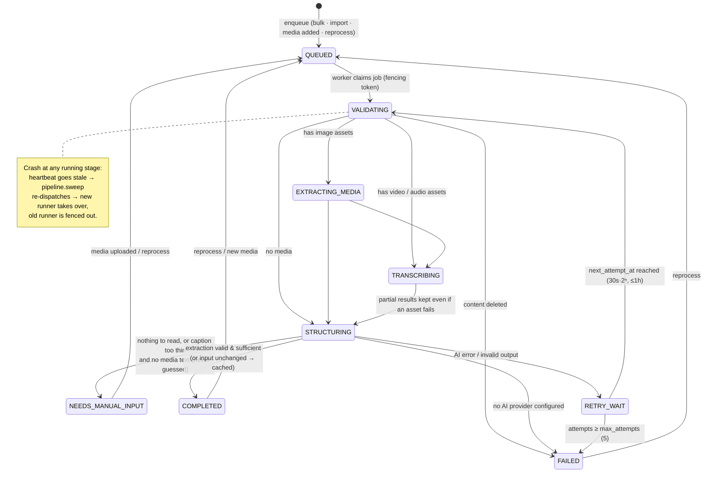
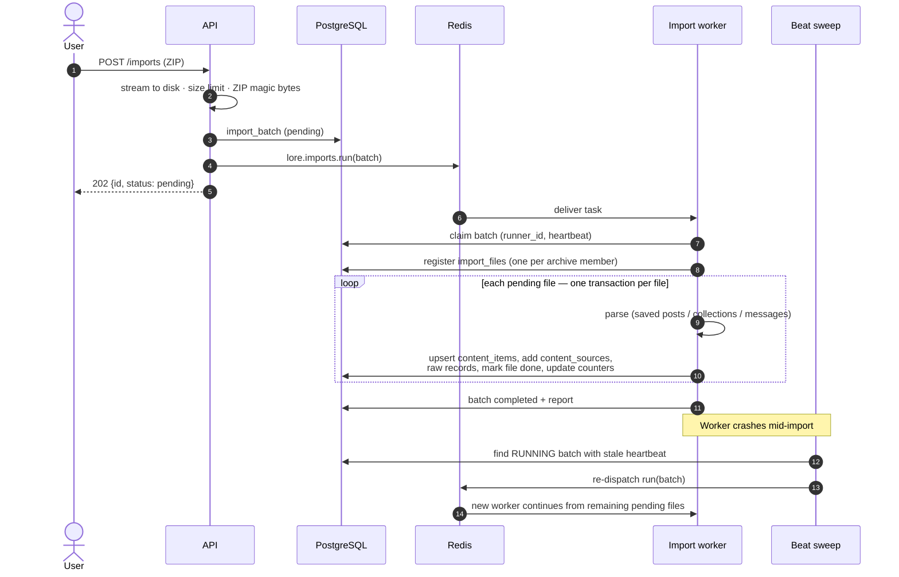
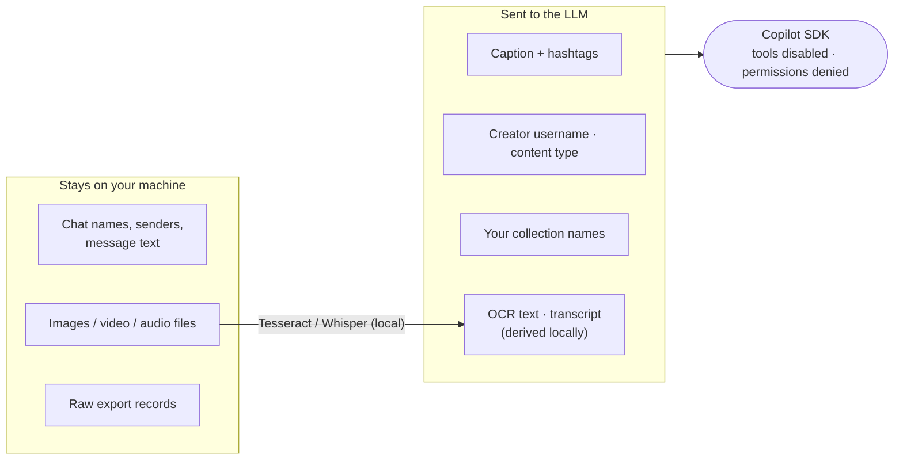

# Lore — Architecture & Flow

Rendered SVGs are in [`diagrams/`](diagrams/) (regenerate (outputs flow-N.svg) with
`npx -p @mermaid-js/mermaid-cli mmdc -i docs/ARCHITECTURE.md -o docs/diagrams/flow.svg`).

Diagrams reflect the implemented system as of 2026-11-07 (Phase 1 complete, Phase 2 in progress).
Decisions referenced as ADR-xxx are in [`DECISIONS.md`](DECISIONS.md).

## 1. End-to-end flow

## 2. Lifecycle of one post's job (`processing_jobs`, one row per post)

## 3. Historical import (resumable)

## 4. What is sent to the AI (privacy boundary)

