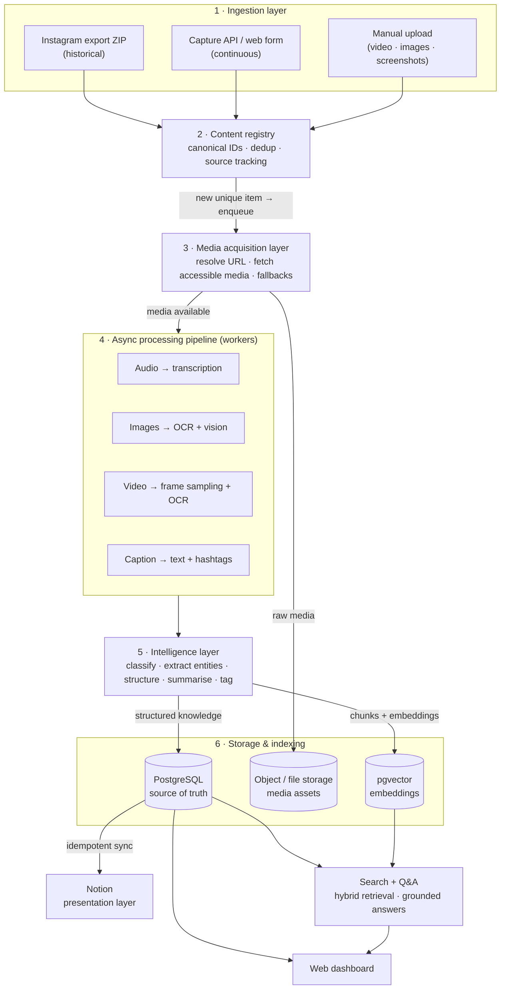
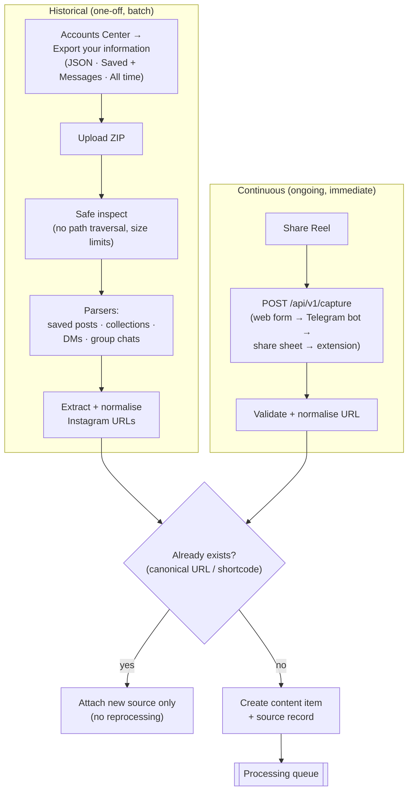
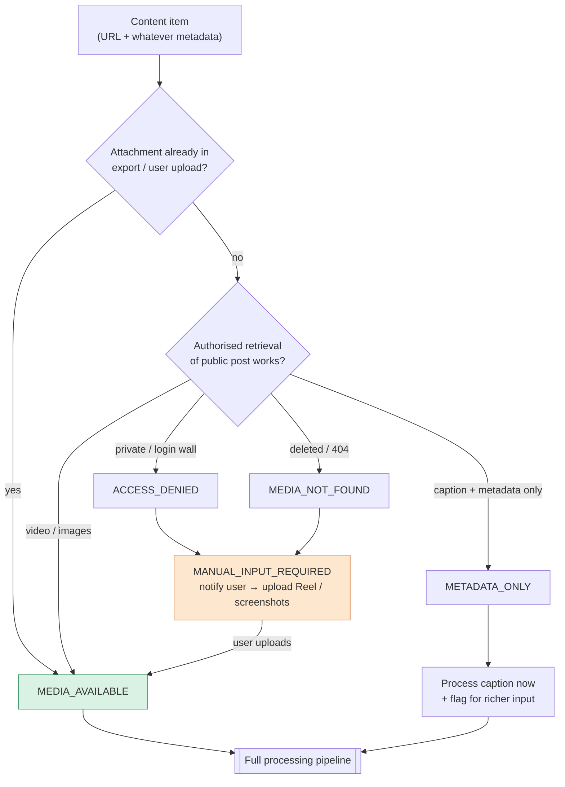
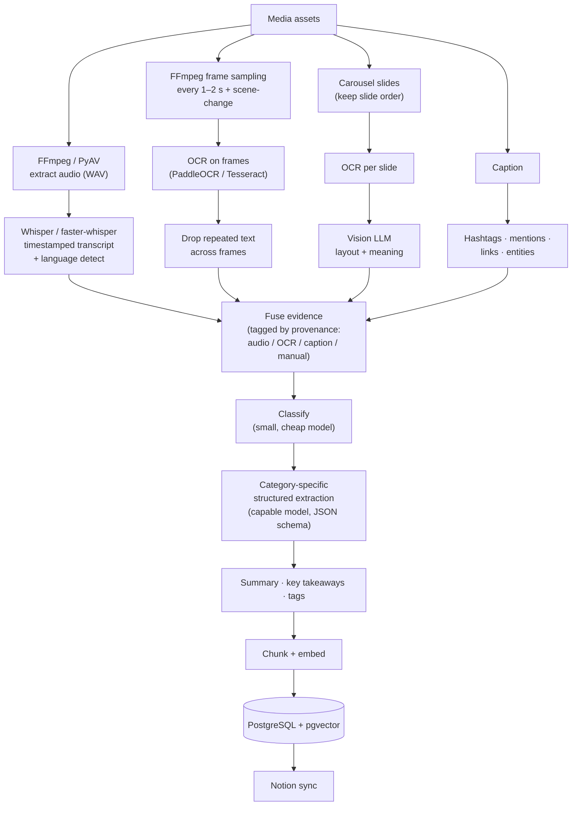
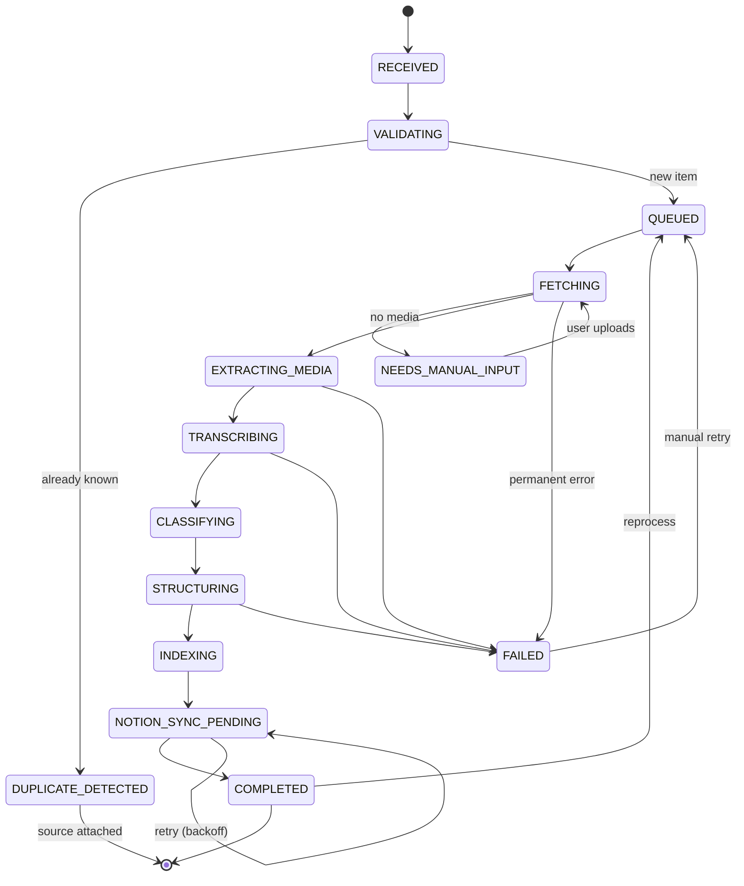
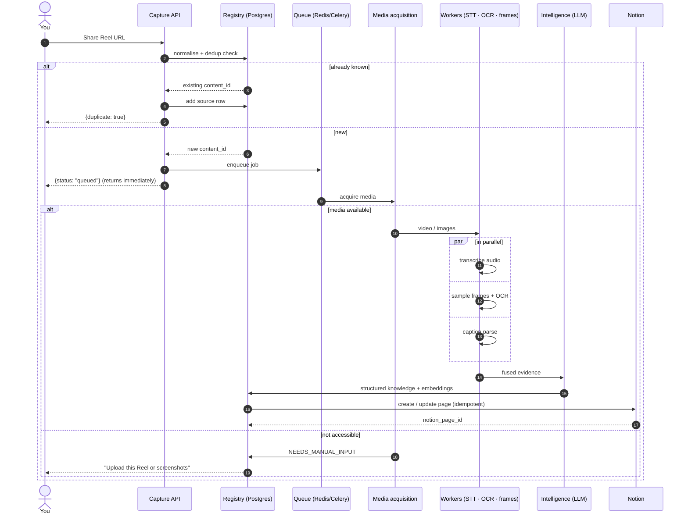
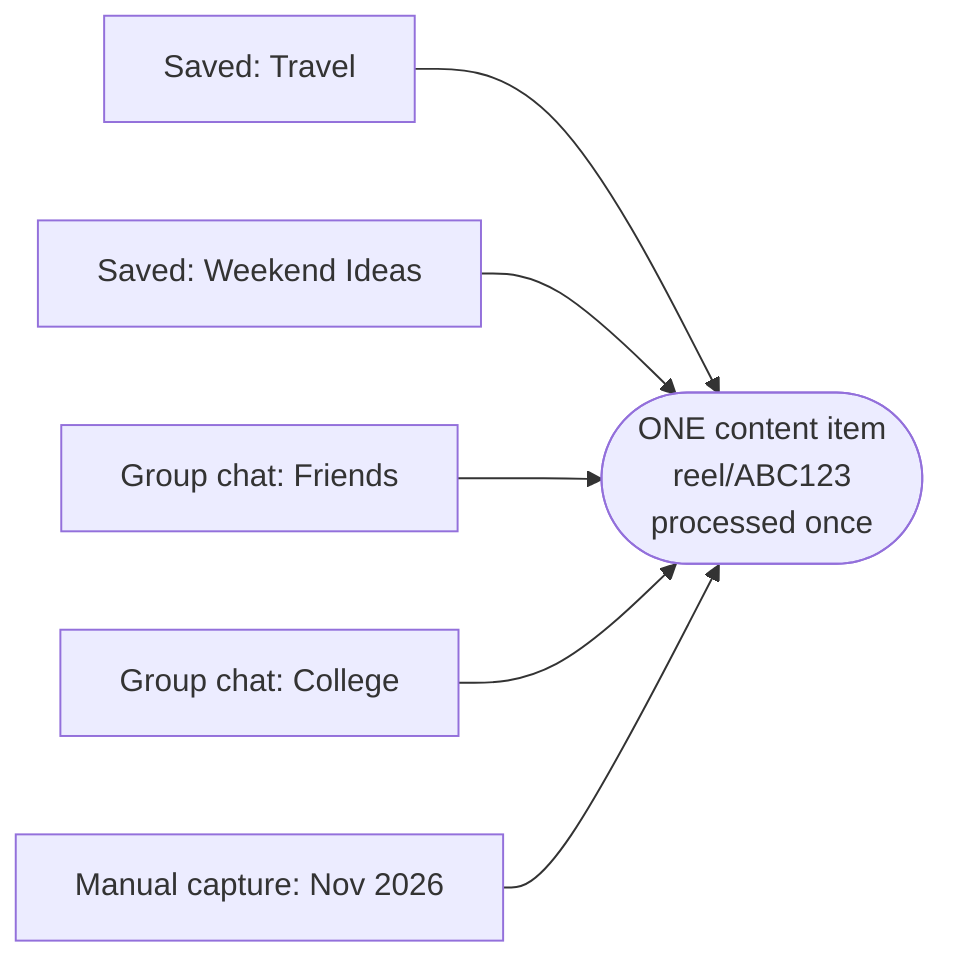
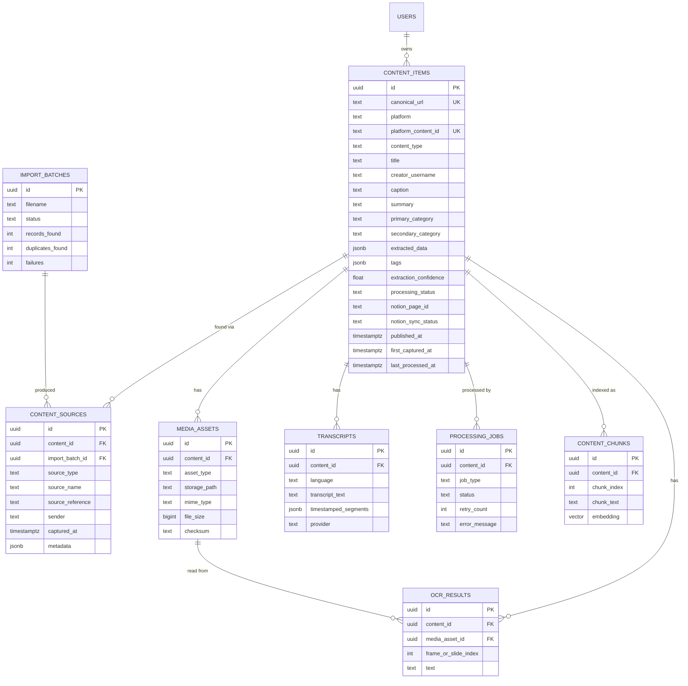
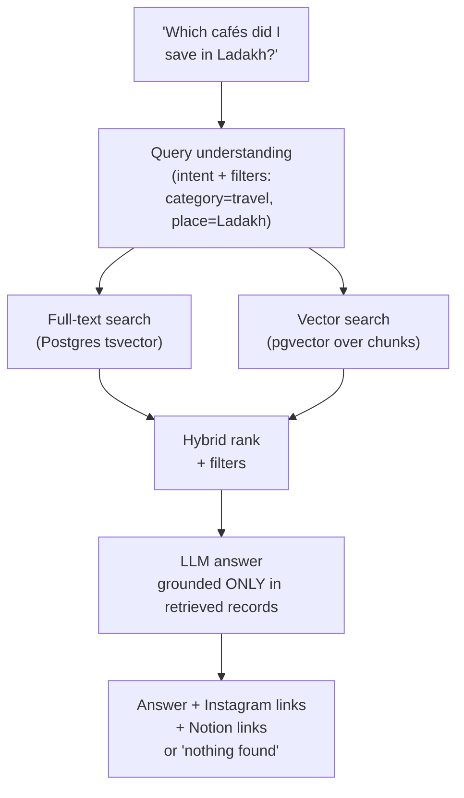
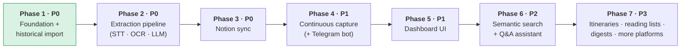

# Lore — Personal Content Intelligence System

> **Working name:** *Lore* (the ChatGPT chat's pick; alternatives were *Sift* and *Mosaic*). The final name isn't settled yet, and "InstaBrain" is retired. The name deliberately leaves Instagram out, because Instagram is only the first source.

**One-line pitch:** You save or share something interesting → Lore captures it → AI understands it → it becomes structured, searchable knowledge → you can ask for it whenever you need it.

**The one metric that matters:** *How easily can the user retrieve useful information they previously discovered and collected?* Optimise for this, not for the number of posts processed.

---

## 1. Problem

Instagram is acting as an **unstructured information repository**, not a knowledge system.

| Pain | Example |
|---|---|
| Forget what was saved | "I know I saved a café in Ladakh…" |
| Can't find the right collection | Same Reel could be in *Travel* or *Weekend Ideas* |
| Group-chat shares get buried | Friends' recommendations scroll away |
| Must rewatch Reels to find one fact | The 3rd book title is only on screen for 2 seconds |
| No cross-source search | Saved posts and DMs live in separate places |
| Duplicates | The same Reel is saved twice and shared in three chats |

**Core principle:** convert unstructured social content into **structured, searchable, reusable knowledge**. The original post always stays linked as the source, and the extracted knowledge must still be useful if the post is later deleted.

---

## 2. Use cases

| # | Use case | Summary |
|---|---|---|
| UC1 | **Historical import** | Upload the Instagram data-export ZIP → parse saved posts, collections and group chats → extract URLs → dedupe → process → Notion |
| UC2 | **Continuous capture** | Share a Reel to Lore (web form → later a Telegram bot / share sheet / extension) → queued → processed automatically |
| UC3 | **Search** | Use keywords, natural language, semantic similarity, or filters (category, tag, creator, source, date) |
| UC4 | **Actionable extraction** | Category-specific schemas: a travel Reel with 6 cafés becomes **6 place entities**, not a one-paragraph summary |

Example questions Lore must answer:
*"Which cafés did I save in Ladakh?"* · *"Recipes with mushrooms"* · *"AI tools I saved for coding"* · *"The Reel with five autumn books"* · *"Everything about Kashmir"*

---

## 3. High-level architecture



### Key architecture decisions

| # | Decision | Why |
|---|---|---|
| D1 | **PostgreSQL is the source of truth; Notion is only for presentation** | Avoids depending on Notion's rate limits, schema limits and uptime. You can swap Notion for something else later without losing data. |
| D2 | **Ingestion is decoupled from processing** | Capture returns immediately, and AI work runs asynchronously on a queue. |
| D3 | **Historical import comes before automation** | Clears the existing backlog first. |
| D4 | **Structured extraction, not generic summaries** | A list of real cafés, books and ingredients is far more useful than a paragraph about a Reel. |
| D5 | **One canonical record, many sources** | The same Reel can be saved in 2 collections and shared in 3 chats and still be processed once. |
| D6 | **Graceful handling of inaccessible media** | Getting media from Instagram is the biggest external risk, so the product must stay useful when it fails. |
| D7 | **Modular monolith + independent workers** | No premature microservices, but module boundaries are clean enough to split out later. |
| D8 | **Provider abstraction for LLM, STT, OCR and embeddings** | You can swap models without rewriting, and set a model per stage to control cost. |

---

## 4. Ingestion flows



**What the export actually contains:** saved posts and collections are **references only** (post URL, creator username, saved-at time, collection name), with *no caption and no media*. Posts and Reels shared in chats arrive as a `share` object with the link, often the caption text, and the original creator. Only things *you* uploaded (your own posts, and photos or videos sent directly in DMs) come as real files. So the export gives you **the list of what to fetch**, and the media acquisition layer has to get the actual content.

**Supported URL shapes:** `/p/`, `/reel/`, `/reels/`, `/tv/`, short links (where resolvable), and URLs with tracking parameters. All are normalised to a canonical form (shortcode-based) without merging unrelated content.

---

## 5. Media acquisition (the hardest problem)

A URL is only a *reference*. It contains no video, audio or images. A successful **capture** is not the same as successful **media acquisition**, and Lore must never pretend it transcribed something it only has a link to.



**Three fallback levels:**

1. **Automatic:** media is available from an authorised source, so it's processed automatically.
2. **Semi-automatic:** only the URL is available, so Lore notifies you to upload the Reel or screenshots.
3. **Manual:** you upload the video, images or screenshots directly.

| Content | Can Lore get the media automatically? |
|---|---|
| Public Reel / carousel | Sometimes (via an authorised retrieval method) |
| Private-account Reel | Usually needs a user upload |
| Saved post (from export) | Export gives a reference, not the media |
| Reel shared in a group chat | Export gives the URL (+ caption text), not the video |
| Screenshot / video you upload | ✅ Yes |

**Guardrails from the spec:** no storing Instagram passwords or session cookies, no bypassing logins, CAPTCHAs or rate limits, and no unrestricted DM scraping. Inaccessible items are **never silently dropped**. They go to `NEEDS_MANUAL_INPUT`.

**Contract sketch:**

```python
class AcquisitionStatus(StrEnum):
    MEDIA_AVAILABLE = "media_available"
    METADATA_ONLY = "metadata_only"
    ACCESS_DENIED = "access_denied"
    MEDIA_NOT_FOUND = "media_not_found"
    MANUAL_INPUT_REQUIRED = "manual_input_required"

class MediaAcquirer(Protocol):
    async def acquire(self, item: ContentItem) -> AcquisitionResult: ...
    # AcquisitionResult: status, assets: list[MediaAsset], caption, metadata, provenance
```

---

## 6. Processing pipeline

Once media is available, the audio, frame and image branches **run in parallel** and then merge in the intelligence layer.



**Rules for the AI layer:**
- Output must match a **validated JSON schema** (Pydantic).
- Label every fact as **explicit**, **inferred** or **unavailable**. Never invent prices, addresses, names or recommendations; unknowns are `null`.
- Record **provenance** for every fact (audio vs on-screen text vs caption vs manual).
- Include a confidence score, flag low-confidence items for review, and allow manual correction.
- Never assume the caption matches what's said in the video.
- Don't OCR every frame: use adaptive sampling plus scene-change detection.

### Category-specific schemas

| Category | Extracted fields |
|---|---|
| ✈️ Travel | destination, places[], location, accommodation, cafés/restaurants, activities, tips, itinerary, cost *(only if stated)* |
| 🍳 Recipe | name, ingredients[] + quantities, steps[], duration, temperature, substitutions |
| 📚 Book | title, author, genre, description, creator's opinion, why it's recommended |
| 💻 Tech | technologies, tools[], concepts, code snippets, tutorials, resources, takeaways |
| 🛍️ Shopping | product, brand, model, price, features, pros/cons, link |
| 🎓 Educational carousel | topic, concepts[], facts, frameworks/steps, examples, references |
| ⏱️ Productivity | technique, routine, steps, tools, actionable recommendations |

**Starting taxonomy (configurable):** Travel · Food & Recipes · Books & Reading · Technology & AI · Career & Learning · Business · Finance · Shopping · Fashion & Beauty · Health & Fitness · Productivity · Lifestyle · Home & Interior · Entertainment · Education · Miscellaneous.

---

## 7. Processing state machine

Every item has an explicit state. Each stage can be retried on its own, and partial results are kept. For example, if Notion sync fails, the transcript is **not** redone; only the sync is retried.



**Job rules:** retry transient errors with exponential backoff, don't retry permanent failures forever, make jobs idempotent, never lose a captured URL if a worker crashes, and keep job state in PostgreSQL (Redis is only the broker).

---

## 8. End-to-end sequence (one Reel)



---

## 9. Deduplication and source tracking



**Match on (strongest first):** canonical URL → platform shortcode / media ID → canonical URL hash → media fingerprint → carefully controlled fuzzy match. **Never merge on caption similarity alone.**

Each source keeps its type, name, timestamp, sender, import batch and original message reference.

---

## 10. Data model



Also include `audit_logs` (entity, action, details JSONB). Index `canonical_url`, `platform_content_id`, `processing_status`, `primary_category`, `published_at`, `captured_at`, `notion_page_id`, plus the full-text and vector indexes. Use UUID primary keys, and don't hard-code single-user assumptions.

---

## 11. Search and Q&A



Embed titles, summaries, takeaways, extracted info and (chunked) transcripts. **Never** embed a long transcript as a single vector. The assistant must say so clearly when nothing matches, and must never invent results.

---

## 12. Notion integration

**Database: `Content Inbox`**

| Property | Type | Property | Type |
|---|---|---|---|
| Title | Title | Tags | Multi-select |
| Source URL | URL | Date Saved | Date |
| Creator | Rich text | Date Published | Date |
| Content Type | Select | Processing Status | Select |
| Primary Category | Select | Extraction Confidence | Number |
| Secondary Category | Rich text | Original Collection | Rich text |
| Summary | Rich text | Content ID | Rich text |
| Review Required | Checkbox | Last Processed | Date |

**Page body:** IG link → metadata → summary → key takeaways → entities → category-specific section → transcript → OCR text → original caption → tags → source history → processing metadata.

**Views:** All · Recently Added · Pending Review · Travel · Books · Food · Tech & AI · Shopping · Tutorials · Productivity · Failed.

**Sync rules:** idempotent (store `notion_page_id` and update rather than duplicate), retry with backoff, respect rate limits and block-size limits, handle archived databases, and support manual resync.

---

## 13. API surface

| Area | Endpoints |
|---|---|
| Capture | `POST /api/v1/capture` |
| Content | `GET /content` · `GET /content/{id}` · `PATCH /content/{id}` · `DELETE /content/{id}` · `POST /content/{id}/reprocess` |
| Imports | `POST /imports` · `GET /imports` · `GET /imports/{id}` · `POST /imports/{id}/resume` |
| Search | `GET /search?q=` · `POST /ask` |
| Notion | `POST /notion/sync/{content_id}` · `POST /notion/sync-all` · `GET /notion/status` |
| System | `GET /health` · `GET /ready` · `GET /api/v1/stats` |

```jsonc
// POST /api/v1/capture
{ "url": "https://www.instagram.com/reel/EXAMPLE/", "source": "manual",
  "collection": "Travel", "notes": "Interesting places to visit" }
// → 202
{ "success": true, "content_id": "uuid", "status": "queued", "duplicate": false }
```

---

## 14. Tech stack

| Layer | Choice |
|---|---|
| Backend | Python 3.12+, FastAPI, Pydantic, SQLAlchemy 2.x, Alembic |
| Database | PostgreSQL + pgvector + JSONB |
| Jobs | Celery + Redis (broker); job state lives in Postgres |
| Media | FFmpeg / PyAV, PaddleOCR or Tesseract, Pillow |
| AI | LLM with structured JSON output; Whisper / faster-whisper; vision LLM; embedding model (all behind interfaces) |
| Frontend | Next.js, TypeScript, React, Tailwind, shadcn/ui *(start with a plain HTML dashboard)* |
| Integrations | Notion API, Instagram export parser, REST capture API |
| Infra | Docker + Docker Compose; local FS first, with an object-storage abstraction later |
| Testing | Pytest, HTTPX, integration and E2E tests, fixture-based parser tests |

**Cost controls:** dedupe *before* AI, cache transcripts and OCR, use a small model for classification and a capable one for extraction, configure models per stage, and track token cost.

**Security:** auth on the dashboard, API keys and rate limits on capture, secrets kept in env/secret manager, no Instagram passwords, safe ZIP extraction (path-traversal guard, size and MIME limits), data export and delete, and no sending unrelated private DMs to AI providers.

---

## 15. Roadmap



| Phase | Definition of done |
|---|---|
| 1 | A real export is uploaded → saved posts and group-chat URLs are extracted → sources preserved → duplicates merged → resumable → import report |
| 2 | A Reel, post or carousel becomes validated structured info with a source reference |
| 3 | Processed items appear in Notion with summary, metadata, extraction and the IG link, with no duplicate pages |
| 4 | Sharing a URL processes it end to end with no manual import |
| 5 | Dashboard, inbox, detail page, import manager, editing, bulk ops, settings |
| 6 | Natural-language questions are answered from stored records, with links |
| 7 | Recommendations, auto-collections, itineraries, reading lists, YouTube/TikTok/Pinterest |

**First deliverable (Phase 1):**

```bash
python -m scripts.inspect_instagram_export /path/to/instagram-export.zip
# → files discovered · saved posts · collections · conversations ·
#   URLs extracted · duplicates · unrecognised files · parse errors
python -m scripts.import_instagram_export /path/to/instagram-export.zip   # → PostgreSQL
```

---

## 16. Repository layout

```
lore/
├── backend/
│   ├── app/
│   │   ├── api/v1/        capture · content · imports · search · notion · system
│   │   ├── core/          config · security · logging
│   │   ├── db/            models/ · repositories/ · session.py
│   │   ├── ingestion/     instagram/ · adapters/ · url_parser.py · deduplication.py
│   │   ├── acquisition/   resolver · upload handler · fallbacks
│   │   ├── processing/    media/ · ocr/ · transcription/ · classification/ · extraction/ · pipeline.py
│   │   ├── integrations/  notion/
│   │   ├── search/        embeddings · retrieval · assistant
│   │   ├── workers/  schemas/  main.py
│   ├── tests/  alembic/  requirements.txt
├── frontend/               (plain HTML dashboard first → Next.js later)
├── scripts/                inspect_instagram_export.py · import_instagram_export.py
├── docs/                   IMPLEMENTATION_PLAN.md · DECISIONS.md · KNOWN_LIMITATIONS.md
├── docker-compose.yml  .env.example  README.md
```

---

## 17. Open decisions

| Decision | Options | Recommendation |
|---|---|---|
| **Final name** | Lore · Sift · Mosaic · Curio · Memora… | **Lore** |
| **Expected volume** | <1k · 1k–10k · 10k–100k · 100k+ | Size it from the real export count |
| **Capture mechanism** | Import + share/paste · auto-monitor IG · manual only | **Import + share/paste** |
| **Processing strategy** | Immediate · scheduled batch · hybrid | **Hybrid**: immediate for new items, batched for the historical backlog |
| **Fallback when media is inaccessible** | Telegram bot upload · web upload | Ask the user; this materially changes reliability |
| **Media retrieval for public posts** | Official/authorised only · unofficial downloader as an opt-in adapter | Keep any unofficial downloader as an **optional, isolated adapter**, never a core dependency |

**Next step:** request the Instagram export (JSON, Saved + Messages, all time). The Phase 1 parser should be built against the **real** export structure, not guessed schemas.
